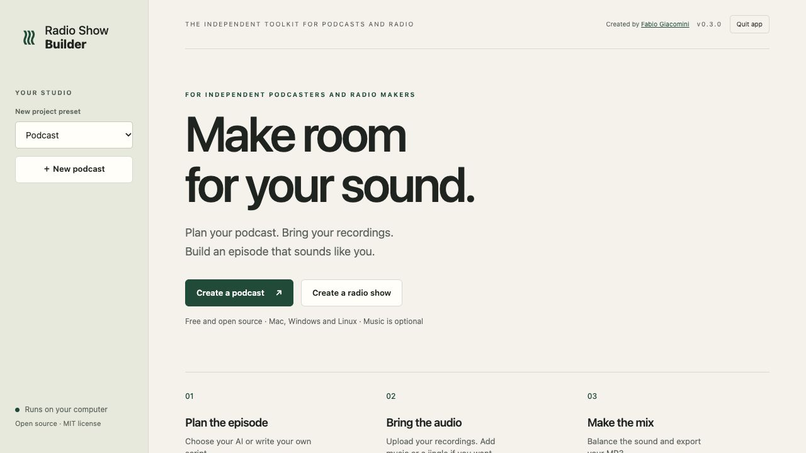
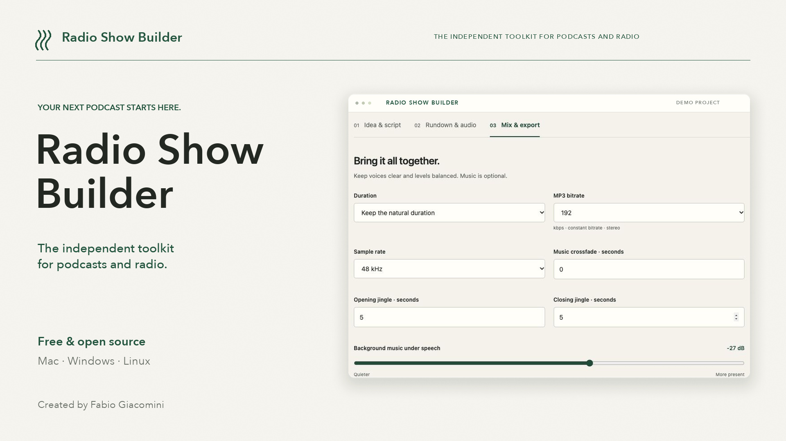

# Radio Show Builder

**The independent toolkit for podcasts and radio.**

Created by **[Fabio Giacomini](https://github.com/fabiogiacomini)**.

A free, open-source app to plan your episode, assemble your recordings and export a balanced MP3. Made for independent podcasters and radio makers, with all audio processing on your own computer. Available for **Mac, Windows and Linux**.

Draft an editable script with your choice of AI, or write it yourself. Upload your spoken recordings, add music or a jingle if you want, and build an episode with clear speech and consistent levels.

The interface and documentation are in English. Scripts can use any language supported by the selected model.

**Status: public preview, [v0.3.0](https://github.com/fabiogiacomini/radio-show-builder/releases/tag/v0.3.0).** Portable desktop packages include Python and the audio engine. The local workflow and provider request formats are covered by automated tests. Presets are configuration starting points; not every model has been tested with a paid account.

## Download the app

| Computer | Direct download |
|---|---|
| Mac with Apple chip, macOS 15+ | [Download for Mac — Apple Silicon](https://github.com/fabiogiacomini/radio-show-builder/releases/download/v0.3.0/Radio-Show-Builder-0.3.0-macOS-arm64.dmg) |
| Mac Intel, macOS 15+ | [Download for Mac — Intel](https://github.com/fabiogiacomini/radio-show-builder/releases/download/v0.3.0/Radio-Show-Builder-0.3.0-macOS-x64.dmg) |
| Windows 10/11 x64 | [Download for Windows](https://github.com/fabiogiacomini/radio-show-builder/releases/download/v0.3.0/Radio-Show-Builder-0.3.0-Windows-x64.zip) |
| Linux x64, glibc 2.35+ (for example Ubuntu 22.04+) | [Download for Linux](https://github.com/fabiogiacomini/radio-show-builder/releases/download/v0.3.0/Radio-Show-Builder-0.3.0-Linux-x64.tar.gz) |

[Launch instructions and system requirements](docs/desktop-downloads.md) · [All release files and checksums](https://github.com/fabiogiacomini/radio-show-builder/releases/tag/v0.3.0)

## For podcasters

Build a spoken-only episode, a narrative podcast, an interview assembled from your own recordings, or a programme with optional music. The **Podcast** preset starts with natural duration and no music slots. No AI key is needed to write, upload, mix and export.

Start with [Create your first podcast](docs/user-guide.md#create-your-first-podcast), or import the [spoken-only example](examples/podcast-rundown.json). Radio makers can choose the **Radio show** preset for a fixed broadcast slot and music-led planning. Both presets use the same editor and can be adjusted freely.

## Features

- Start with a podcast or radio preset; describe an idea, audience, language, tone and planning duration.
- Make a spoken-only podcast or choose an optional musical proportion for the draft.
- Choose an AI service or connect a local model. Model IDs remain freely configurable.
- Edit the running order, full spoken scripts and production notes.
- Download a Word document containing the script and rundown.
- Skip AI entirely and write or import a rundown yourself.
- Upload MP3, WAV, FLAC, M4A, OGG or AAC audio.
- Reorder or remove segments, reuse uploaded files and choose explicit trim points.
- Optionally add an opening and closing jingle and a quiet bed under spoken segments.
- Normalise speech and music separately, crossfade adjacent tracks and limit final peaks.
- Export a verified stereo MP3 at 128, **192**, 256 or 320 kbps constant bitrate.
- Download the final running order and technical report.

Original recordings remain unchanged. This app does not download music, clone voices or generate spoken audio.

## Install and run

### Download a portable app

Choose your computer on the [Downloads page](https://github.com/fabiogiacomini/radio-show-builder/releases/tag/v0.3.0): **Mac with Apple chip**, **Mac Intel**, **Windows x64** or **Linux x64**. Python and FFmpeg are included. Extract or install the package, open Radio Show Builder, and use it in your browser. Use **Quit app** when finished.

These first builds are not Apple notarized or Windows publisher signed. See [platform requirements, launch instructions and checksums](docs/desktop-downloads.md). They are portable packages, not app-store installations. The app's own code is MIT licensed; bundled third-party components have separate licenses. Exact corresponding FFmpeg and LAME sources are included with the release.

### Run from source

You need **Python 3.10 or later** and **FFmpeg** with the libmp3lame encoder.

~~~sh
# macOS with Homebrew
brew install ffmpeg

# Debian or Ubuntu
sudo apt install ffmpeg
~~~

On Windows, install FFmpeg and add its bin folder to PATH. RSB_FFMPEG can also point to the executable's full path.

~~~sh
git clone https://github.com/fabiogiacomini/radio-show-builder.git
cd radio-show-builder
python3 -m venv .venv
source .venv/bin/activate
python -m pip install .
radio-show-builder
~~~

On Windows PowerShell, activate the environment with:

~~~powershell
.venv\Scripts\Activate.ps1
python -m pip install .
radio-show-builder
~~~

The app opens a private local URL in your browser. Keep the computer running while building a show. Use Quit app to stop, or press Ctrl+C in the source version's terminal after the current task completes.

~~~sh
radio-show-builder --port 8766 --data-dir ./my-local-shows
radio-show-builder --no-browser
~~~

No account with this project, subscription to this app, Node.js installation or hosted backend is required.

## Your choice of AI

| Service | Connection |
|---|---|
| OpenAI | Responses API |
| Anthropic Claude | Messages API |
| Google Gemini | OpenAI-compatible API |
| OpenRouter | OpenAI-compatible API |
| Mistral | OpenAI-compatible API |
| DeepSeek | OpenAI-compatible API |
| Groq | OpenAI-compatible API |
| Together AI | OpenAI-compatible API |
| Ollama | Local OpenAI-compatible API |
| LM Studio | Local OpenAI-compatible API |
| Custom service | Configurable URL, model and API format |

Custom services can use OpenAI-compatible Chat Completions, OpenAI Responses or Anthropic Messages. Other authentication schemes and proprietary formats require another adapter.

Model IDs are not hard-coded. Load the catalogue from your account or enter a model ID manually. Choose a text-generation model.

For local inference, install and start Ollama or LM Studio separately and load a suitable model. A cloud key is normally unnecessary. Performance depends on the model and your computer.

Remote services charge under their own terms. There is no automatic paid fallback. A draft sends one generation request; loading models sends a catalogue request. A chat subscription does not itself provide an API key.

See [AI providers](docs/ai-providers.md).

## Workflow

1. Choose **Podcast** or **Radio show**, then describe the episode and select its language, tone and planning duration.
2. Generate a draft or choose **Write it myself**.
3. Review facts, wording and track versions.
4. Download the Word script, record speech with any tool and upload all audio.
5. Arrange the rundown, optionally attach a jingle and check the duration.
6. Build the MP3, listen, then download the episode and production report.

Word edits are not automatically imported: copy revised passages into the app. Rundown JSON export/import is supported; it contains scripts and settings, not audio or credentials.

## Duration and sound

| Starting preset | Script planning goal | Music in draft | Export duration |
|---|---|---|---|
| Podcast (default) | 30 minutes | 0%, spoken only | Natural |
| Radio show | 90 minutes | 83% | Exact target |

Both start at **192 kbps, 48 kHz stereo**. All settings can be changed. Presets apply only when creating a project; opening an older project preserves its settings. Music percentage guides the draft, not the final mix or a required quota.

**Natural duration** preserves the selected programme length, including crossfades and jingle sections.

**Exact duration** uses decoded sample counts. It can extend the closing jingle by up to two additional minutes. If content is too long, the editor must remove segments or set trim points. Speech is never accelerated or shortened automatically.

The jingle ducks into initial speech and rises after final speech. When a jingle is assigned, under spoken segments it is kept much quieter than the voice. It repeats with short fades at loop boundaries when needed.

Each source is normalised separately. The complete mix receives a global loudness adjustment and an oversampled peak limiter. The encoded MP3 is checked for duration, constant bitrate, sample rate and true peak.

See [Audio production](docs/audio-production.md) and [User guide](docs/user-guide.md).

## Privacy and storage

The server binds only to 127.0.0.1 and uses a private per-launch session. API keys stay in page/request memory; they are not saved in projects, exports or logs.

The selected AI receives your idea, language, tone, research notes and production brief. Audio is processed locally and is not uploaded to the AI. There are no analytics or remote fonts.

Projects and audio are stored in .radio-show-builder in your home folder, or the data directory you select. Keep this directory and backups private. A long show can require several gigabytes of free disk space.

This is a single-user local app, not a public hosting service. Do not expose its port through a public tunnel.

## Development

~~~sh
python -m pip install -e .
python -m unittest discover -s tests -v
~~~

Tests use generated signals and mock provider servers, never private recordings or paid API calls. Install FFmpeg for audio integration tests.

See [Architecture](docs/architecture.md), [Contributing](CONTRIBUTING.md) and [Security](SECURITY.md).

For native build steps, license notices and release checks, see [Desktop builds](docs/desktop-builds.md).

## License

Radio Show Builder was created by **Fabio Giacomini** and is distributed under the MIT license. Copyright (c) 2026 Fabio Giacomini. See [LICENSE](LICENSE).

When redistributing copies or substantial portions of this software, retain the copyright notice and MIT license. The original app also displays a visible creator credit; MIT does not require derivative applications to retain the same interface or an on-screen credit.

This license covers the code. Audio, scripts, model services and dependencies retain their applicable terms.
